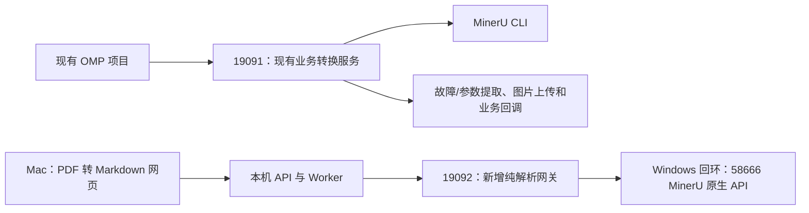

# M2：与现有 OMP 转换服务隔离的接入方案

日期：2026-10-24。状态：源码核实后提出的实施方案，尚未部署新服务，真实转换仍未完成验收。

## 源码核实结果

本机提供的 `omp-doc-convert/` 是另一个项目的服务副本，仅用于本地参考，不提交其中的源码、配置或业务产物。

| 位置 | 观察到的行为 | 对小工具的影响 |
| --- | --- | --- |
| `app.py:SubmitRequest`、`submit` | JSON 提交，认证头为 `X-Submit-Secret`；需要租户、文档、尝试次数、源文件 URL 和回调 URL 等业务字段 | 不是普通 multipart PDF 上传接口 |
| `app.py:run_task` | 转换前先回调，然后下载 PDF、转换、生成派生产物，再回调成功/失败 | 不适合作为独立上传下载工具的直接入口 |
| `converter.py:convert_pdf_to_markdown` | 以子进程执行 `mineru -p ... -o ...` | 这份源码没有通过 58666 HTTP API 转发解析 |
| `converter.py:optimize_markdown_and_upload` | 无条件进入专用表格优化；按配置上传图片；部分故障表格会转为专门的故障文本 | 不能将“优化版”视为通用、未加工的 MinerU 正文 |
| `derived_outputs.py:build_derived_outputs` | 无条件进行故障和参数提取，再生成合并 Markdown 等派生产物 | `requiredOutputTypes=[]` 不能关闭这些操作 |
| `app.py:find_task` | 返回状态、清单路径和输出描述；主要正文通过业务回调传递 | 不能假定轮询响应会直接返回 Markdown，Windows 路径也不能由 Mac 直接读取 |

以上是提供副本的源码行为；运行中的服务是否与该副本完全一致仍需部署方确认。HTTP 探测已确认路由与认证错误相符，没有执行业务任务验证。

## 推荐拓扑

19092 是建议值，启用前确认未被占用。现有 19091 的端口、路由、默认处理行为、密钥、目录、数据库、回调和调用方配置均保留。

新增网关建议放在独立目录，例如 `D:\services\pdf2markdown-gateway`，使用独立 Python 虚拟环境、配置、日志及服务名称。仅安装轻量 HTTP 网关依赖，优先复用已运行的原生解析 API，不复制 OMP 应用、不导入其 converter 模块，不在原有 Anaconda 环境中升级依赖。

## 新网关的职责与契约

1. 先在 Windows 本机以只读方式核实 `http://127.0.0.1:58666/openapi.json` 和 `/health`，确认它确为原生 MinerU API，检查版本、任务接口和部署参数。现在并未取得这一实例的实际 OpenAPI，不能预先认定与官方包完全一致。
2. 对外只提供本工具需要的原生兼容接口：`/openapi.json`、`/health`、`POST /tasks`、`GET /tasks/{task_id}`、`GET /tasks/{task_id}/result`；若实际原生部署只支持同步入口，再按实际契约适配。
3. 通过 multipart 上传文件，返回原始 Markdown、middle_json、content_list 和真实引擎版本。按已经观察到的契约映射状态；不返回业务故障提取结果，不接受任意回调地址。
4. 使用固定回环上游地址，不按客户端传入的 URL 转发。OpenAPI 中的内部地址/路径需适配对外入口，不能只暴露文档而不转发实际请求。上游返回的 localhost 链接不得交给 Mac 直接访问。
5. 为新网关配置独立 Bearer token，后端通过本地 `.env` 的 `MINERU_API_KEY` 使用，不复用 OMP 提交密钥。服务绑定和 Windows 防火墙只允许实际需要的局域网来源。
6. 使用独立任务命名空间/网关任务映射，约束任务查询、文件上限、并发和超时；具体持久化与过期规则需随真实上游契约验证。原生服务自己的输出目录和模型配置先检查，不能为小工具擅自覆盖已用服务的配置。
7. 本机 `.env` 的 `MINERU_BASE_URL` 改为新增入口；前端继续只访问本机 API。若新网关保持已核对的原生契约，可复用当前适配器，仍需真实联调确认。

Markdown 通用整理、表格规范化、语义分块、章节上下文、编辑和两种下载均由本项目负责，按 M2/M3/M4 计划实现和验收。网关不承担故障/参数专项提取，也不连接 FastGPT、MinIO 或 OMP 回调。

## 隔离的边界

独立入口能隔离代码、业务流程、配置和数据，**不能消除共用 GPU、显存、CPU、内存和磁盘的竞争**。当前 OMP 使用 CLI，新网关使用原生 API，两者的队列/并发上限彼此独立；只给新网关设置并发 1，不代表全机最多同时解析一个任务。`queueSize=0` 也不能证明 OMP 没有正在处理的任务。

- 如果要求严格不影响既有项目的性能和可用性，需要独立 GPU/机器及资源约束，或安排可验证的互斥运行窗口。
- 如果允许共享资源，先限制新服务并发和文件规模，在约定窗口进行小样例测试并观察显存和既有业务延迟。遇到竞争就暂停新服务任务，而不是调整既有业务参数。
- 若必须实现统一优先级和全局并发，需要两个调用链共同使用调度器/锁；这会涉及 OMP 的受控改造，作为单独变更评审，不属于本次默认方案。

## 不优先采用的路径

- 不向现有 `/convert/submit` 填充虚拟业务字段或伪造回调，仅为拿到 Markdown。
- 不使用现有服务的“合并版”或“优化版”作为纯解析结果，再尝试删除故障段落；专用转换可能已经改变原表格结构。
- 不直接修改 19091 的默认行为或增加全局开关，避免既有项目收到不同内容。
- 如将来必须共用 19091，需采用明确版本化的独立接口/处理管线，默认保持旧行为，并覆盖旧调用方回归。相比新增进程，这仍会带来现有服务重启和依赖耦合，因此不作为此次首选。

## 实施与验收顺序

1. Windows 本机核实 58666 的 OpenAPI、版本和资源占用，确认新增端口与可用资源方案。
2. 在本仓库开发并离线测试独立网关：认证、限额、代理、任务恢复、错误透传、路径隔离，确认没有 OMP 专项导入和调用。
3. 交付独立 Windows 启动配置，部署到新目录和新端口；旧服务无需停机或改配置。
4. 本机切换新入口，分别提交仓库内文本型和纯图像扫描型样例，核对两页正文、中文、表格值、结构化产物与版本；记录转换耗时。
5. 验证网页预览、编辑、分块、两种 Markdown 下载和重启恢复。结构化精确页码及表格高级处理按里程碑范围如实报告。
6. 如需并行验证既有项目，使用部署方明确的测试任务及原有调用链，不将合成任务发向生产业务回调。新服务回滚只停止自身并恢复本工具连接配置；不修改或删除旧服务数据。

M2 只有在新入口契约和真实转换验证通过后才能标记完成。当前提交仅保存分析方案及本地参考目录隔离规则，不声称新网关已经开发、部署或通过测试。
